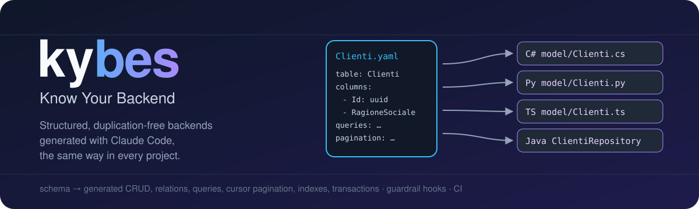
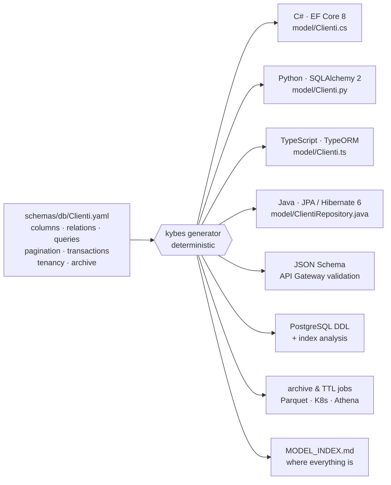
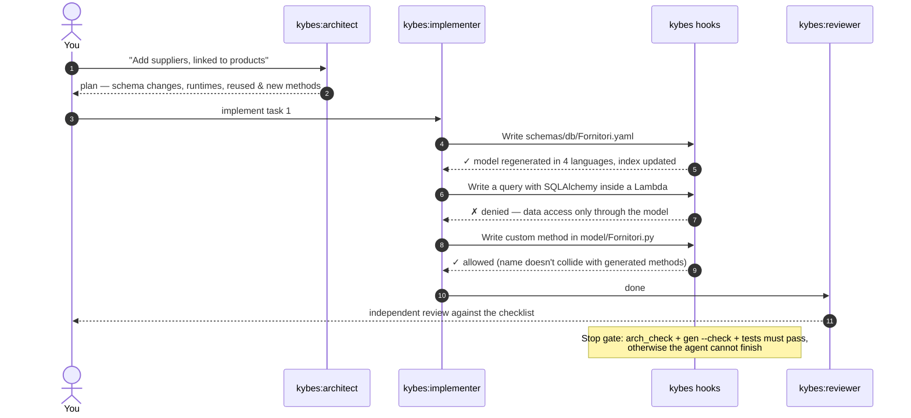

<p align="center">
  
</p>

<p align="center">
  <a href="https://github.com/ivandilelio/kybes/actions/workflows/kit-tests.yml"></a>
  
  
  
</p>

# kybes — Know Your Backend

**kybes is a Claude Code plugin that makes AI-generated backends predictable.** Every project gets the same folders, the same file names and the same data-access methods. There is no duplicated code, and every rule that can be checked automatically is enforced as a hook or a CI step, not left to a prompt.

> After a million lines of generated code across different projects, you should still know without searching that `src/model/Clienti.cs` holds the CRUD, relations and custom queries of the `Clienti` table. kybes makes that true.

---

## Why

Asking an AI to "follow our architecture" works only some of the time. Instructions get lost when the context grows. Planners and subagents may never see them. Two runs of the same prompt produce two different layouts. kybes takes a different approach:

| Problem | What kybes does |
|---|---|
| Repetitive code written differently each time | A **deterministic generator** writes it from a YAML schema, byte-identical across projects |
| Rules forgotten by planners and subagents | Rules are **preloaded into dedicated agents** and **loaded per folder** |
| Rules ignored under pressure | **Hooks** reject non-compliant writes and **block completion** until checks pass |
| Code duplicated across services | A **duplicate-code gate** fails the work, and the fix is always to extract |
| Slow queries discovered in production | Every declared access path gets a **covering index**, computed automatically |

## How it works



For each table, every language gets two files:

- `model/generated/<Table>` holds the entity, CRUD, relations, declared queries, cursor pagination and validation. It is **regenerated** and nobody edits it.
- `model/<Table>` is the **only** place for custom methods of that table. In C# it is a `partial class`; in the other languages it is a subclass.

### Life of a change with Claude Code



## A schema in, the same API out

```yaml
# schemas/db/Ordini.yaml
table: Ordini
columns:
  - { name: Id, type: uuid, primary_key: true }
  - { name: Numero, type: string, length: 20, required: true, unique: true }
  - { name: ClienteId, type: uuid, required: true }
  - { name: Data, type: date, required: true }
relations:
  - { name: Cliente, kind: many_to_one, target: Clienti, foreign_key: ClienteId }
queries:
  - name: DelClienteDal
    where: [ClienteId, { column: Data, op: gte, param: DaData }]
    order_by: [{ column: Data, dir: desc }]
pagination:
  default_order: [{ column: Data, dir: desc }]
  sortable: [Data, Numero]
```

| Generated method | C# | Python | TypeScript / Java |
|---|---|---|---|
| read by key | `GetByIdAsync` | `get_by_id` | `getById` |
| cursor page, UI-selectable sort | `ListPageAsync` | `list_page` | `listPage` |
| create / update / delete (validated) | `CreateAsync` … | `create` … | `create` … |
| by unique column | `FindByNumeroAsync` | `find_by_numero` | `findByNumero` |
| page by foreign key | `ListByClienteIdAsync` | `list_by_cliente_id` | `listByClienteId` |
| parent of a relation | `GetClienteAsync` | `get_cliente` | `getCliente` |
| declared query | `ListDelClienteDalAsync` | `list_del_cliente_dal` | `listDelClienteDal` |

The generator also creates the index `(ClienteId, Data)` that covers both `listByClienteId` and `DelClienteDal`, and records the decision in `db/generated/indexes.md`.

## Features

| Area | What you get | Status |
|---|---|---|
| **Data model** | entities, CRUD, relations (incl. hierarchies), validation and default values in C#, Python, TypeScript and Java | ✅ available |
| **Declared queries** | `eq`, `ne`, `lt`…`gte`, `in`, `prefix` (LIKE-safe), `is_null`; returning a page, a list or one row | ✅ available |
| **Index analysis** | ideal index per access path; missing indexes created, redundant ones flagged; `varchar_pattern_ops` for prefix search | ✅ available |
| **Cursor pagination** | keyset `PageRequest → Page {items, nextCursor}` from UI to DB; cursor format identical across languages | ✅ available |
| **Transactions** | Unit of Work with per-table isolation level and automatic retry on serialization failures and deadlocks | ✅ available |
| **PostgreSQL DDL** | complete schema with constraints and indexes, validated by the PostgreSQL parser | ✅ available |
| **Guardrail hooks** | data access outside the model, generated files, folder layout, method collisions, secrets, duplicates | ✅ available |
| **Unit tests to ISO 26262-6** | requirement IDs and test cases derived from each schema (requirements analysis, equivalence classes, boundary values, error guessing, MC/DC for ASIL C/D); runnable pytest and node:test suites; traceability matrix; coverage gate per table ASIL; mandatory traced tests for custom methods | ✅ available |
| **Multi-tenancy** | per table: tenant column (every method filtered, unique constraints per tenant, PostgreSQL row-level security), schema per tenant, or database per tenant; tenant bound to the ORM session; generated isolation tests | ✅ available |
| **Hot/cold archive** | old rows move to Parquet on S3/Azure Blob, partitioned by tenant and date; every file is verified (rows, keys, SHA-256) before the rows leave the hot table, and an interrupted move is completed by the next run; `getById` can read through to the archive in all four languages; Athena tables and Synapse views generated | ✅ available |
| **Retention (TTL)** | archive partitions or hot rows deleted after a declared age; jobs as Kubernetes CronJob, KEDA ScaledJob triggered by backlog, or 24/7 engine; one job engine with its own generated tests | ✅ available |
| **MongoDB** | same repository interface over MongoDB in all four languages | 🗺️ planned |

## Guardrails

| When | Check | Default |
|---|---|---|
| before every write | ORM or DB driver imported outside the model (all 4 languages) | block |
| before every write | edits to generated files, JSON Schemas, DDL, generated jobs, `MODEL_INDEX.md` | block |
| before every write | a file in `model/` that doesn't map to a table, or a sub-folder | block |
| before every write | a custom method named like a generated one | block |
| before every write | secrets in clear text (AWS keys, private keys, tokens, passwords) | block |
| before finishing | a custom model method without a traced test (`TC-<Table>-…`) in `tests/custom/` | block |
| after every write | schema saved → model regenerated in every language; linters; architecture warnings | — |
| before finishing (main agent and every subagent) | `arch_check` (incl. duplicated blocks of 8+ lines), `gen --check`, `verify.py` (model tests + coverage per ASIL), your test commands | block |
| in CI | the same checks, `--strict` | fail build |

Every rule can be set to `block`, `warn` or `off` in `.claude/kybes.config.json`, a file the agent is not allowed to modify.

## Predictable layout

```text
your-project/
├── schemas/
│   ├── db/<Table>.yaml                  ← yours: the single source of truth
│   └── generated/json/<Table>.schema.json
├── libs/db-models/<language>/…/model/
│   ├── <Table>.{cs,py,ts} | <Table>Repository.java   ← yours: custom methods only
│   └── generated/                       ← generator only
├── libs/db-models/<language>/tests/
│   ├── generated/                       ← ISO 26262-6 unit tests, generator only
│   └── custom/                          ← yours: tests of your custom methods
├── docs/generated/verification/         ← requirements, test specs, traceability, coverage policy
├── db/generated/ddl/postgres/_all.sql   ← DDL, indexes.md
├── db/generated/{athena,synapse}/       ← queries over the Parquet archive
├── jobs/generated/<table>-archive/      ← job config + Kubernetes manifest (CronJob, KEDA, Deployment)
├── jobs/generated/_engine/              ← archive & TTL job engine with its tests and Dockerfile
├── services/<context>/{functions,ms}/   ← Lambda / Kubernetes handlers
├── jobs/  libs/utils/  libs/errors/  frontend/  infra/
├── MODEL_INDEX.md                       ← tables → files → methods
└── .claude/kybes.config.json
```

**The rule:** everything under a `generated/` folder belongs to the generator; everything else is yours.

## Install

**From Claude Code (marketplace):**

```text
/plugin marketplace add ivandilelio/kybes
/plugin install kybes@kybes
```

Then, inside a project, ask Claude *"set up kybes in this project"*. This runs the `kybes:kybes-init` skill, which asks for the model languages and creates the configuration, path rules, the CLAUDE.md block, an optional scaffold and the CI workflow. The hooks stay inactive in repositories that have not been set up.

**From the command line:**

```bash
git clone https://github.com/ivandilelio/kybes
kybes/install.sh --target /path/to/project --scaffold --examples \
  --model-langs csharp,python,typescript,java
```

The installer is idempotent. Teammates run `tools/kybes/setup.sh` once after cloning the project.

### Requirements

| Generated code | Needs |
|---|---|
| C# | `net8.0`, Microsoft.EntityFrameworkCore 8 and a provider (e.g. Npgsql) |
| Python | Python 3.9+, SQLAlchemy 2 |
| TypeScript | TypeORM, `reflect-metadata`, `experimentalDecorators` and `emitDecoratorMetadata` |
| Java | Jakarta Persistence 3.1, Hibernate 6.2+, Jackson for `json` columns |
| archive jobs | Python 3.10+, SQLAlchemy 2, pyarrow, psycopg 3; boto3 or azure-storage-blob (all in the generated `pyproject.toml` and `Dockerfile`) |
| hooks and generator | `python3` (standard library only) |

## How kybes itself is verified

`tests/run.sh` installs kybes into throw-away projects and checks the generated code:

| | Verification |
|---|---|
| Python | real CRUD, relations, cascades, unique constraints, pagination edge cases (ties, tampered cursors, disallowed sorts), every query operator, and Unit of Work commit, rollback and retry, on SQLite |
| TypeScript | the same scenarios on sql.js; `strict` + `noUnusedLocals` compilation for the PostgreSQL dialect |
| Generated tests | the ISO 26262-6 suites generated into the sample project run green in all four languages (Python and TypeScript also on PostgreSQL), within the ASIL coverage thresholds; mutants (dropped query condition, off-by-one length or page limit, flipped keyset comparator, retry off-by-one) are killed |
| Java | `javac -Xlint:all -Werror` against faithful JPA/Hibernate stubs locally; in CI the generated JUnit 5 suite runs on Hibernate 6 and PostgreSQL 16, with JaCoCo coverage within the ASIL thresholds |
| C# | tree-sitter syntax check locally; in CI the model builds with `-warnaserror` and the generated xUnit suite runs on EF Core 8 and PostgreSQL 16, with coverlet coverage within the ASIL thresholds |
| SQL | generated DDL parsed by the PostgreSQL parser (`pglast`); in CI row-level security, schema and database per tenant run on PostgreSQL 16 |
| Archive jobs | the engine's own suite at 100% branch coverage on SQLite and PostgreSQL; a real job run through the CLI (move, child kept, retention, read-through from the Python model); Parquet layout read by DuckDB; S3 via moto and Azure Blob via Azurite; Kubernetes manifests parsed; the RLS check against a role without `BYPASSRLS` |
| Cross-language | a cursor produced by TypeScript, Python or Java is accepted by the others |
| Hooks | every rule with its expected outcome (deny/allow), auto-regeneration, duplicate detection, stop gate |


## Documentation

The detailed documentation is in Italian, in [`docs/`](docs/README.md):
- [architecture](docs/architettura.md)
- [folder map](docs/struttura-cartelle.md)
- [schema reference](docs/schema-yaml.md)
- [generator](docs/generatore.md)
- [queries & indexes](docs/query-e-indici.md)
- [pagination](docs/paginazione.md)
- [transactions](docs/transazioni.md)
- [guardrails](docs/controlli.md)
- [multi-tenancy](docs/multi-tenant.md)
- [archive & retention](docs/archivio.md)
- [unit verification (ISO 26262-6)](docs/verifica.md)
- [configuration](docs/configurazione.md)
- [roadmap](docs/roadmap.md)
- [developing the kit](docs/sviluppo.md)

## A note on ISO 26262

kybes automates the part of ISO 26262-6 that can be automated at software-unit level: requirement-based test derivation, structural coverage criteria per ASIL, and bidirectional traceability. Compliance is still a property of your whole development process (safety plan, hazard analysis, tool qualification, independent reviews), and certification remains your organisation's step.

## Author

Ivan Di Lelio · [Meta Innovation](https://www.metainnovation.it)
